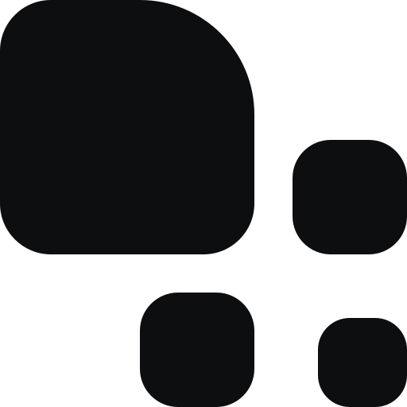

<picture>
  <source media="(prefers-color-scheme: dark)" srcset="assets/arkerion-logo-blanc.svg">
  
</picture>

  

**Développement web et logiciel.**

[Documentation](https://arkerion-hq.github.io/Arkerion-Docs/) · [Nebula](https://github.com/arkerion-hq/nebula) · [Contact](mailto:arkerion.contact@gmail.com)

---

## Bienvenue

Arkerion conçoit des applications web et des outils logiciels : des produits concrets, construits avec soin, du code jusqu'à l'identité visuelle. Une partie de notre travail est publiée ici, en open source.

## Produits

<table>
  <tr>
    <td width="72" align="center">
      <picture>
        <source media="(prefers-color-scheme: dark)" srcset="assets/nebula-symbole-blanc.svg">
        
      </picture>
    </td>
    <td>
      <b><a href="https://github.com/arkerion-hq/nebula">Nebula</a></b> 
      Le logiciel phare d'Arkerion. <a href="https://arkerion-hq.github.io/Arkerion-Docs/docs/produits/nebula">Documentation</a>
    </td>
  </tr>
</table>

## Arkerion sur GitHub

Chaque dépôt affiche dans son README un badge qui indique son statut :

| Badge | Signification |
| :---: | --- |
|  | Produit maintenu et suivi par Arkerion, prêt à être utilisé. |
|  | Projet en cours de développement : il peut changer en profondeur ou ne pas aboutir. |
|  | Bibliothèque ou utilitaire au service de nos produits, réutilisable ailleurs. |
|  | Projet qui n'est plus maintenu, conservé pour référence. |

## Identité

Le logo, les couleurs et les polices Arkerion Sans et Arkerion Mono sont documentés sur le [site d'Arkerion](https://arkerion-hq.github.io/Arkerion-Docs/docs/identite/logo), avec leurs règles d'usage.

## Contribuer

Les signalements de bugs, les idées et les contributions sont les bienvenus :

- **Un bug ou une idée ?** Ouvrez une *issue* dans le dépôt concerné, en décrivant le contexte et ce que vous attendiez.
- **Une contribution ?** Proposez une *pull request* avec une description claire du changement. Pour un changement important, ouvrez d'abord une *issue* pour en discuter.
- **Une faille de sécurité ?** Ne la publiez pas : écrivez à [arkerion.contact@gmail.com](mailto:arkerion.contact@gmail.com).

## Code de conduite

Nous voulons que chacun puisse participer dans un cadre respectueux, quel que soit son niveau ou son parcours.

**On attend de chacun :**

- d'échanger avec respect et bienveillance, même en cas de désaccord ;
- de critiquer les idées et le code, jamais les personnes ;
- d'accepter les retours constructifs et de reconnaître ses erreurs ;
- d'aider les nouveaux venus plutôt que de les juger.

**Ne sont pas acceptés :**

- les insultes, le harcèlement et les attaques personnelles ;
- les propos discriminatoires, quelle qu'en soit la cible ;
- la publication d'informations privées sans autorisation ;
- tout comportement qui empêche les autres de participer sereinement.

**Signaler un problème :** écrivez à [arkerion.contact@gmail.com](mailto:arkerion.contact@gmail.com). Chaque signalement est traité de façon confidentielle. Selon la gravité, la réponse peut aller du simple rappel des règles à l'exclusion des projets Arkerion.

---

© Arkerion · <a href="mailto:arkerion.contact@gmail.com">arkerion.contact@gmail.com</a>

